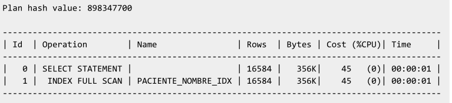

## Octubre 29

[t-04.pdf](notas_prof/t-04-parte-1.pdf)

### Index unique scan


### Index Range Scan

Es escaneo 

- Un operador SQL que pudiera devolver mas de un registro -> Resuelve en un index Range Scan 

- También pude funcionar con la igualdad
  
  ```sql
  select * from paciente where
      email = 'x@x.com';
  ```
  
  Sí el indice es del tipo **non unique** -> el optimizado empleará **index range scan**
  
  ¿por que no usaría el índice?
  
  Ejemplo
  
  ```sql
  explain plan for
  select email from paciente where email like 'bob@%' order by email desc;
  select plan_table_output from table(dbms_xplan.display);
  ```
  
  -> range scan

- sdss

### Index Full Scan

Hace una consulta del $100\%$ de los rowid que contiene el índice

Cuando una BD quiere todo los datos de una columna y se requieren ordenados

```sql
select email
from paciente where email is not nul -- para agesurarse que no intente graesrse nulos y asi si usar el indice
order by email asc;
```

```sql
explain plan for
select nombre from paciente order by nombre;
select plan_table_output from table(dbms_xplan.display);
```




