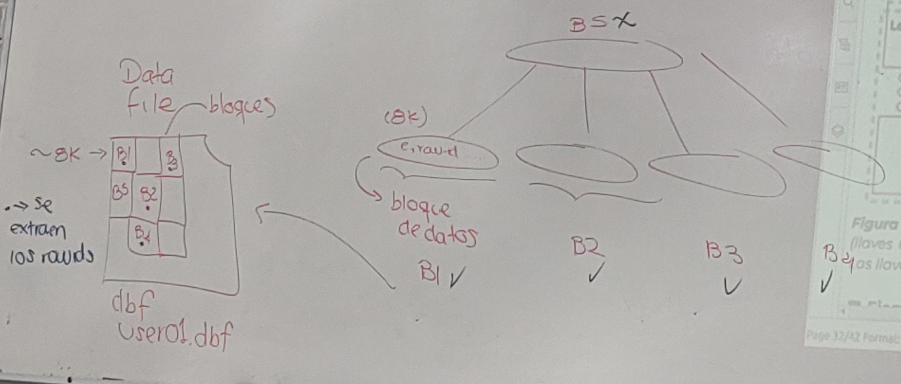
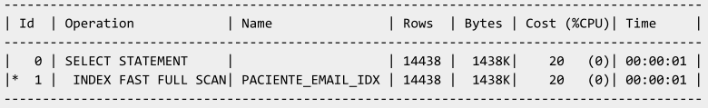
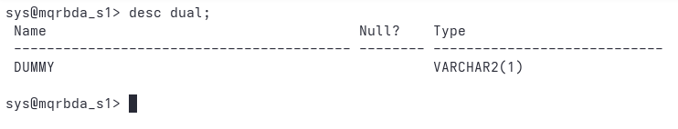

## Octubre 29

[t-04.pdf](notas_prof/t-04-parte-1.pdf)

### Index unique scan

### Index Range Scan

Es escaneo 

- Un operador SQL que pudiera devolver mas de un registro -> Resuelve en un index Range Scan 

- También pude funcionar con la igualdad
  
  ```sql
  select * from paciente where
      email = 'x@x.com';
  ```
  
  Sí el indice es del tipo **non unique** -> el optimizado empleará **index range scan**
  
  ¿por que no usaría el índice?
  
  Ejemplo
  
  ```sql
  explain plan for
  select email from paciente where email like 'bob@%' order by email desc;
  select plan_table_output from table(dbms_xplan.display);
  ```
  
  -> range scan

- sdss

### Index Full Scan

Hace una consulta del $100\%$ de los rowid que contiene el índice

Cuando una BD quiere todo los datos de una columna y se requieren ordenados

```sql
select email
from paciente where email is not nul -- para agesurarse que no intente graesrse nulos y asi si usar el indice
order by email asc;
```

```sql
explain plan for
select nombre from paciente order by nombre;
select plan_table_output from table(dbms_xplan.display);
```


### Index Fast Full Scan

Cuando se requieren todos los rowid, pero no importa el ordenamiento

##### ¿Cómo se guarda un índice de manera física?



```sql
sql
select email
from paciente where email is not nul; -- para agesurarse que no intente graesrse nulos y asi si usar el indice
```



¿Que sucede acá?

```sql
select 1+1 from paciente; -- que pasa aca ?
sect 1+1 from dual; -- uso de la tabla dummy
select 1+1; -- apartir de 23ai
```

Por cada renglon que ecuentres en la table, ejecuta esto

```sql
select [] from tabla; -- por cada renglon de la table ejecuta la consulta []
select upper(nombre) from tabla ; -- por cada renglon de la table, ejecuta la funcion
select fecha_nac +1 from tabla; -- por cada renglon de la tabla ejecuta la expresi
```

#### Ejemplo 2



```shellsession
sys@mqrbda_s1> desc dual;
 Name					   Null?    Type
 ----------------------------------------- -------- ----------------------------
 DUMMY						    VARCHAR2(1)

sys@mqrbda_s1> select 1+1 from dual;

       1+1
----------
	 2

sys@mqrbda_s1> select 1+1;

       1+1
----------
	 2

sys@mqrbda_s1> 
```

##### ¿Qué metodo se acceso es el mas eficiente para saber todos los registros de una tabla?

```sql
SELECT /*+ INDEX_FFS(t nombre_del_indice_pk) */ COUNT(columna_pk)
FROM tu_tabla t;
```

Otro ejemplo

tiene nulos

```sql
explain plan for
    select count (*) from paciente
select plan_table_output from table(dbms_xplan.display);
```

Si se va a usar el indice gracias a count ya que count **no usa los nulos**

-  Cuando se pone * : sdsd -> Saber el número de registros de una tabla; no valida nulos

- Cunando se pone email:  

consulta mas eficiente posible para que muestre cuantos paientes no tienen email

```sql
select count(*) form praciente
    where email is null; --- la mas simple ; el plan de ejecucion no usará el índice xq email tiene nulos

select count (*) - count( email )  from paciente ; -- plan must¿ gives  IDX_FFS

-- buscar otra sintaxis que haga casi lo mismo
 


```

## Skip Index Scan

+ Consulta no incluye en el predicado la primera columna del índice

+ Primera columna tiene muy pocos valores distintos

+ Segunda columna tiene una gran cantidad de valores distrintos

| pago_orden            |
| --------------------- |
| odden_id<br> num_pago |
| --- columns           |

```sql
create unique index p_ix
    on pago_orden( orden_id, pago );

--- consultas que quieran usar este indice compuesto
where orden-id ----   Importa el orden en el que se define el indice y luego en el que se usa
```

Puede ayudar cuando el indice se creoi al reves

| genero | email                    | paciente |
| ------ | ------------------------ | -------- |
| F      | wolf@company.example.com | rowid    |
|        |                          |          |
|        |                          |          |
|        |                          |          |
|        |                          |          |

```sql
select * from paciente 
```


Como indece fue creado al revez, no se puede usar el indeice

```sql
-- ejemplo en que el manejador transforma la sentencia
select * from paciente
where genero = 'F' and email = 'abbey@company.example.com'
union all
select * from paciente
where genero = 'M' and email = 'abbey@company.example.com';
```

fue factible xq el numero de registros distintos de la primer columna no es mucho, de lo contrario tendría 

En este método se hace una transformación SQL


Hasta pagina 36
